<!-- ===================== HERO: FACE + INFO CARD ===================== -->

  
  &nbsp;
  

<h1 align="center">
  
</h1>

  
  
  

<!-- ===================== ABOUT ===================== -->
<h2>👨‍💻 About Me</h2>

I'm a passionate <b>Full Stack Web Developer</b> from India 🇮🇳 who enjoys building modern,
responsive and user-friendly web applications, with strong APIs behind them.

<ul>
  <li>💻 Frontend with <b>React.js</b> and <b>Next.js</b></li>
  <li>⚙️ Backend with <b>Node.js</b> and <b>Express.js</b></li>
  <li>🗄️ Databases with <b>MongoDB</b> and <b>Mongoose</b></li>
  <li>🔐 Auth systems: JWT, refresh sessions, OTP login, role-based access</li>
  <li>🐍 Growing in <b>Python</b> and <b>TypeScript</b></li>
  <li>🚀 I enjoy building real-world projects end to end</li>
  <li>⚡ Fun fact: I debug with <code>console.log</code> and pray 🙏</li>
</ul>

 

<!-- ===================== TECH STACK ===================== -->
<h2>🛠️ Tech Stack</h2>

<h3>Languages</h3>

  

<h3>Frontend</h3>

  

<h3>Backend &amp; Database</h3>

  

<h3>Tools &amp; Platforms</h3>

  

<!-- ===================== PROJECTS ===================== -->
<h2>🚀 Featured Projects</h2>

<table align="center">
  <tr>
    <td width="50%" valign="top">
      <h3>🔐 Auth Management App</h3>
      
A full-stack role-based authentication system.

      <ul>
        <li>🔑 JWT access + refresh sessions</li>
        <li>📧 OTP login with Nodemailer</li>
        <li>👥 Role-based access control</li>
      </ul>
      
<code>React (Vite)</code> · <code>Express</code> · <code>MongoDB</code>

    </td>
    <td width="50%" valign="top">
      <h3>🛒 E-Cart System</h3>
      
A full-stack e-commerce app with product browsing and cart.

      <ul>
        <li>🛍️ Product listing · 🔎 Search</li>
        <li>🛒 Shopping cart</li>
        <li>🔐 Login &amp; Register · 🌐 REST API</li>
      </ul>
      
<code>React (Vite)</code> · <code>Node/Express</code> · <code>MongoDB</code>

      <a href="https://github.com/avnish-prajapati/ecart-system">View repo →</a>
    </td>
  </tr>
  <tr>
    <td width="50%" valign="top">
      <h3>📊 Next.js Data Table</h3>
      
An Excel-style data management application.

      <ul>
        <li>➕ Add / ✏️ Update / 🗑️ Delete records</li>
        <li>🔍 Search · 🎯 Filter · ↕️ Sort</li>
        <li>📄 Pagination · 💾 LocalStorage</li>
      </ul>
      
<code>Next.js</code> · <code>React</code>

    </td>
    <td width="50%" valign="top">
      <h3>🧠 Quiz Application</h3>
      
An interactive quiz app built with React.js.

      <ul>
        <li>❓ Multiple choice questions</li>
        <li>🏆 Score calculation</li>
        <li>➡️ Navigation · 📊 Result display</li>
      </ul>
      
<code>React</code> · <code>JavaScript</code>

    </td>
  </tr>
  <tr>
    <td width="50%" valign="top">
      <h3>📝 React Text Utils</h3>
      
A text utility app for different text operations.

      <ul>
        <li>Uppercase &amp; lowercase conversion</li>
        <li>Word count · character count</li>
        <li>Reading time · live preview</li>
      </ul>
      
<code>React</code> · <code>JavaScript</code>

    </td>
    <td width="50%" valign="top">
      <h3>✨ More coming soon</h3>
      
I'm always building something new. Check my repositories for the latest work.

      <a href="https://github.com/avnish-prajapati?tab=repositories">All repositories →</a>
    </td>
  </tr>
</table>

<!-- ===================== STATS ===================== -->
<h2>📊 GitHub Statistics</h2>

  
  

<h2>🔥 GitHub Streak</h2>

  

<h2>📈 Contribution Graph</h2>

  

<h2>🐍 Contribution Snake</h2>

  

Updated automatically by the Platane/snk GitHub Action.

<h2>🏆 GitHub Trophies</h2>

  

<!-- ===================== LEARNING + GOALS ===================== -->
<table align="center">
  <tr>
    <td width="50%" valign="top">
      <h2>📚 Currently Learning</h2>
      <ul>
        <li>⚡ Advanced JavaScript</li>
        <li>🔷 TypeScript</li>
        <li>🐍 Python</li>
        <li>⚛️ Advanced React.js</li>
        <li>▲ Next.js</li>
        <li>🟢 Node.js &amp; Express.js</li>
        <li>🔐 Authentication &amp; Authorization</li>
      </ul>
    </td>
    <td width="50%" valign="top">
      <h2>🎯 2026 Goals</h2>
      <ul>
        <li>🚀 Become a strong Full Stack Developer</li>
        <li>📚 Master JavaScript, TypeScript and React.js</li>
        <li>▲ Build production-ready Next.js apps</li>
        <li>🛠️ Build more real-world projects</li>
        <li>🐙 Stay consistent with GitHub contributions</li>
        <li>💼 Prepare for a software development career</li>
      </ul>
    </td>
  </tr>
</table>

<!-- ===================== QUOTE ===================== -->

  

<h2 align="center">💡 Developer Mindset</h2>

  <b>Code → Learn → Build → Break → Fix → Repeat 🔥</b>

  <i>"Consistency beats motivation."</i>

<!-- ===================== CONNECT ===================== -->
<h2 align="center">📫 Connect With Me</h2>

  
  
  <!--
    Add these when you have your real links (replace YOUR-... part), then remove the arrows around each block:

  
  
  
  
  -->

<h3 align="center">🚀 Let's Build Something Awesome Together!</h3>

⭐ Thanks for visiting my profile!

  

