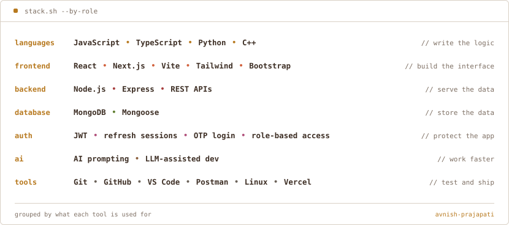
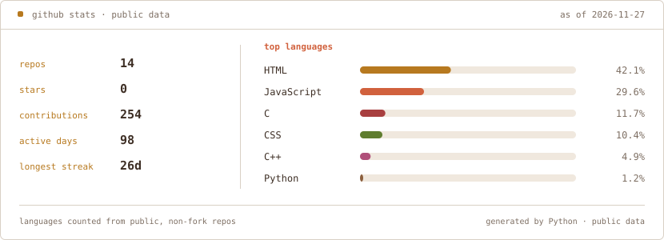
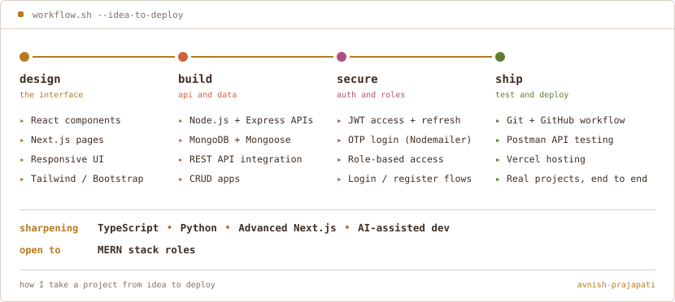

<!-- ===================== 1. WHO I AM ===================== -->

  
  &nbsp;
  

<!-- ===================== 2. ABOUT ===================== -->
<h3 align="center"><code>avnish@github:~$ cat about.md</code></h3>

<b>MERN stack developer</b> from India 🇮🇳. I build and ship full-stack apps: React and Next.js interfaces,
Node and Express APIs, MongoDB data and secure login systems. 
6 projects built · open to MERN stack roles.

<ul>
  <li>💻 Frontend with <b>React.js</b> and <b>Next.js</b></li>
  <li>⚙️ Backend with <b>Node.js</b> and <b>Express.js</b>, data in <b>MongoDB</b></li>
  <li>🔐 Auth systems: JWT, refresh sessions, OTP login, role-based access</li>
  <li>🤖 <b>AI prompting</b> and LLM-assisted development</li>
  <li>⚡ Fun fact: I debug with <code>console.log</code> and pray 🙏</li>
</ul>

<!-- ===================== 3. WHAT I CAN DO ===================== -->
<h3 align="center"><code>avnish@github:~$ ./stack.sh --by-role</code></h3>

  

<!-- ===================== 4. PROOF: PROJECTS ===================== -->
<h3 align="center"><code>avnish@github:~$ ls projects/</code></h3>

<table align="center">
  <tr>
    <td width="50%" valign="top">
      <h3>🔐 Auth Management App</h3>
      
A full-stack role-based authentication system.

      <ul>
        <li>🔑 JWT access + refresh sessions</li>
        <li>📧 OTP login with Nodemailer</li>
        <li>👥 Role-based access control</li>
      </ul>
      
<code>React (Vite)</code> · <code>Express</code> · <code>MongoDB</code>

      <!-- add your link: <a href="https://github.com/avnish-prajapati/REPO-NAME">View repo →</a> -->
    </td>
    <td width="50%" valign="top">
      <h3>🛒 E-Cart System</h3>
      
A full-stack e-commerce app with product browsing and cart.

      <ul>
        <li>🛍️ Product listing · 🔎 Search</li>
        <li>🛒 Shopping cart</li>
        <li>🔐 Login &amp; Register · 🌐 REST API</li>
      </ul>
      
<code>React (Vite)</code> · <code>Node/Express</code> · <code>MongoDB</code>

      <a href="https://github.com/avnish-prajapati/ecart-system">View repo →</a>
    </td>
  </tr>
  <tr>
    <td width="50%" valign="top">
      <h3>🏦 Banking System</h3>
      
A banking system application, built as a team project.

      
<code>Team project</code>

    </td>
    <td width="50%" valign="top">
      <h3>📊 Next.js Data Table</h3>
      
An Excel-style data management application.

      <ul>
        <li>➕ Add / ✏️ Update / 🗑️ Delete records</li>
        <li>🔍 Search · 🎯 Filter · ↕️ Sort</li>
        <li>📄 Pagination · 💾 LocalStorage</li>
      </ul>
      
<code>Next.js</code> · <code>React</code>

    </td>
  </tr>
  <tr>
    <td width="50%" valign="top">
      <h3>🧠 Quiz Application</h3>
      
An interactive quiz app built with React.js.

      <ul>
        <li>❓ Multiple choice questions</li>
        <li>🏆 Score calculation</li>
        <li>➡️ Navigation · 📊 Result display</li>
      </ul>
      
<code>React</code> · <code>JavaScript</code>

    </td>
    <td width="50%" valign="top">
      <h3>📝 React Text Utils</h3>
      
A text utility app for different text operations.

      <ul>
        <li>Uppercase &amp; lowercase conversion</li>
        <li>Word count · character count</li>
        <li>Reading time · live preview</li>
      </ul>
      
<code>React</code> · <code>JavaScript</code>

    </td>
  </tr>
</table>

<a href="https://github.com/avnish-prajapati?tab=repositories">All repositories →</a>

<!-- ===================== 5. CONSISTENCY: ACTIVITY + STATS ===================== -->
<h3 align="center"><code>avnish@github:~$ ./contributions.sh</code></h3>

  

  

<!-- ===================== 6. HOW I WORK: WORKFLOW ===================== -->
<h3 align="center"><code>avnish@github:~$ ./workflow.sh --idea-to-deploy</code></h3>

  

<b>Plan → Build → Test → Fix → Ship 🔥</b>

<!-- ===================== 7. CONTACT ===================== -->
<h3 align="center"><code>avnish@github:~$ ./contact.sh</code></h3>

  
  
  <!--
    Add these when you have your real links (replace the YOUR-... part), then remove the arrows around each block:

  
  
  -->

  thanks for visiting &nbsp;·&nbsp;
  

  

